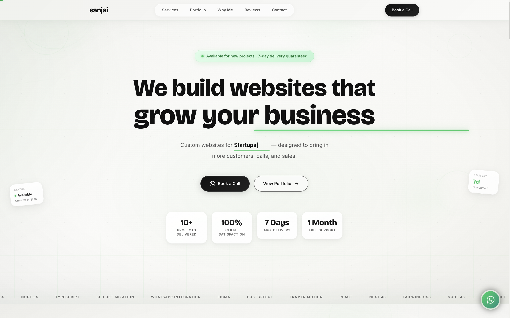

<div align="center">

# Sanjai — Freelance Web Development

### Modern websites designed to help businesses grow.

[](https://sanjai-alpha.vercel.app/)

<br />



</div>

---

## ✦ About

A modern freelance web-development website built to showcase services, work, client-focused solutions, and the development process.

The design focuses on **clarity, conversion, responsive design, and premium user experience**.

---

## ✨ Features

- Modern responsive UI
- Premium visual design
- Smooth animations & micro-interactions
- Services showcase
- Portfolio/work showcase
- Client-focused sections
- Reviews/testimonials
- Contact & booking CTA
- Mobile responsive
- Performance optimized

---

## 🛠 Built With

`Next.js` · `React` · `TypeScript`  
`Tailwind CSS` · `Framer Motion` · `Vercel`

---

## 🚀 Run Locally

```bash
git clone https://github.com/Sanjai-Gopal/Sanjai.git
cd Sanjai
npm install
npm run dev
